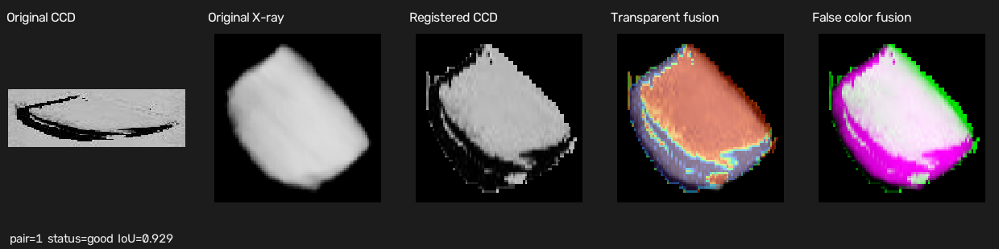
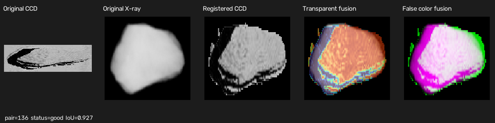
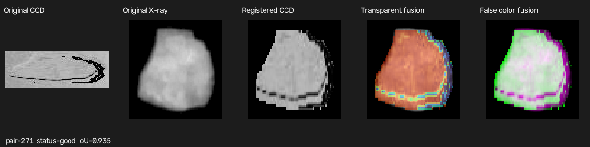
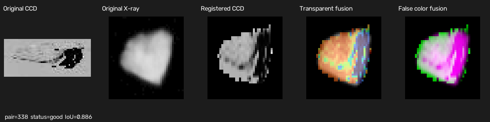

# CCD/激光雷达与 X 光图像配准融合

这个项目处理传送带上同一批物体的两路图像：CCD 侧提供强度图和深度图，X 光侧提供 16 位灰度图。程序先从连续帧中找出物体并裁切，再解决两台相机时间不同步、两边偶尔漏检的问题，最后把 CCD 物体变换到 X 光坐标系中，输出透明叠加和伪彩融合结果。

课题要求里把 CCD 侧称为“激光雷达图像”。代码实际读取的是强度 JPG 和带符号深度 TIFF，所以本文统一写成“CCD/雷达侧”。目前做的是二维深度图和强度图处理，还没有把深度反投影成三维点云，也没有进行多台雷达的外参标定。这个范围要先说清楚，不然后面的“点云融合”容易被写得比代码实际完成的更多。

## 现在完成了什么

目前的完整流程是：

~~~text
CCD 深度图 + 强度图
  -> 多帧背景建模
  -> 前景检测和连通域筛选
  -> 边界碎片回查
  -> 相邻帧物体拼接
  -> 目标裁切与导出

X 光 16 位图像
  -> 阈值和亮核心筛选
  -> 连续帧分组
  -> 同一物体跨帧关联
  -> 选择最完整的一帧并导出

两路目标序列
  -> 估计相机时间差
  -> 允许漏检的序列匹配
  -> 估计全局横纵尺度和旋转
  -> 逐对中心对齐与小范围平移
  -> 透明融合、伪彩融合和结果统计
~~~

程序分成两个可执行文件。image_fusion 负责原始图像检测、跨帧处理和裁切导出，register_objects 只读取已经导出的目标做配准。这样调配准参数时不需要重新跑一遍原始数据。

## 代码放在哪里

config/config.yaml 保存原始数据路径、CCD 检测参数和 X 光检测参数。config/registration.yaml 保存序列关联、尺度搜索、复核阈值和融合显示参数。

src/io 负责文件配对、图像读取和结果导出。src/common 负责 YAML 配置和进度显示。

src/ccd 是 CCD 主流程：

- ccd_preprocess.cpp：buildCcdBackground 建背景，detectCcd 生成前景 mask。
- ccd_sequence.cpp：解析时间戳，并用 analyzeCcdMask 记录面积、外接矩形、质心和边界位置。
- ccd_crop.cpp：cropCcdObjects 同步裁切强度、深度和 mask。
- ccd_allmediaprocess.cpp：把上面几个单帧步骤串起来。
- ccd_temporal.cpp：processCcdTemporalObjects 完成边界碎片回查、跨帧关联、重叠判断和拼接。

src/x/x_objects.cpp 负责 X 光目标跨帧编号和最佳观测选择；X 光读取、阈值分割和分组在 src/io/data_loader.cpp 中。

src/registration/object_registration.cpp 是配准核心，包括序列动态规划、尺度和旋转标定、仿射变换、IoU/Dice 计算以及融合图生成。src/registration/registration_config.cpp 读取配准配置。

src/main.cpp 是检测和导出入口，src/registration_main.cpp 是配准入口。tests 里有 CCD 边界恢复、导出数据类型和带漏检序列匹配的测试。

主要函数调用关系可以简化成：

~~~text
image_fusion
  loadConfig
  inspectCcdFolder -> loadCcdPairs
  buildCcdBackground
  ccd_allmediaprocess
    detectCcd -> analyzeCcdMask -> cropCcdObjects
  processCcdTemporalObjects
  loadXrayData -> generateXrayMask
  processXrayObjects
  exportObjectResults

register_objects
  loadRegistrationConfig
  registerExportedRun
    loadObjects
    associateObjectSequences
    calibrateScaleAndRotation
    warpAffine
    writeExamples
~~~

## 编译和运行

项目使用 C++17、CMake 和 OpenCV。在项目根目录运行：

~~~powershell
cmake -S . -B build-new
cmake --build build-new
ctest --test-dir build-new --output-on-failure
~~~

先处理原始图像并导出目标：

~~~powershell
.\build-new\image_fusion.exe .\config\config.yaml --export-only
~~~

不加 --export-only 会在导出后打开 CCD 和 X 光预览窗口。

然后对同一批导出结果进行配准：

~~~powershell
.\scripts\run_registration.ps1
~~~

也可以指定批次，避免自动选择最新的共同批次：

~~~powershell
.\scripts\run_registration.ps1 -RunName run_1791773122600
~~~

## 参数怎么调

原始检测参数在 config/config.yaml。

CCD 当前使用：

- 无效深度值 -32768，背景至少需要 80% 的有效样本。
- 深度与背景相差超过 12，或者强度相差超过 25，都可以成为前景。
- 形态学核为 3，先开运算去除零散点，再闭运算连接小间隙。
- 连通域最小面积为 250，裁切时四周补 5 像素。

这里不能只靠面积筛噪声。之前把面积阈值降低后出现的大块噪声，本质上是背景纹理在强度差分后连成了区域；现在使用强度差、深度差、开闭运算和面积一起限制。阈值太高会漏掉右上角那类小物体，太低又会把背景起伏当成物体。

X 光当前使用：

- 低阈值 2500 生成候选区域，面积至少 300。
- 候选内部还要有至少 20 个像素高于 5000，用来排除只有暗边缘的噪声。
- 只检测横坐标 [70, 870)，相邻帧间隔按 185 ± 5 ms 分组。
- 跨帧关联的水平区间 IoU 至少为 0.5。

配准参数在 config/registration.yaml。当前允许序列搜索半径为 8，跳过一个单侧目标的代价为 0.95；全局尺度在初值上下 15% 内以 0.01 搜索，旋转在 -5° 到 5° 内以 1° 搜索，每一对最后只允许 ±3 像素残余平移。IoU 低于 0.50 标为 review，低于 0.30 标为 low_score。

CCD 跨帧拼接参数目前仍是 CcdTemporalOptions 中的默认值，还没有全部放进 YAML。这是参数化要求里尚未完全收尾的一点。主要默认值是最大帧间隔 450 ms、水平重叠率 0.50、重叠行搜索 2～30、冗余融合阈值 0.65。

## CCD 目标提取和跨帧补全

### 背景和单帧检测

buildCcdBackground 使用开头最多 20 帧。每个像素只统计有效深度，并取中值作为背景深度；对应位置的强度也取中值。有效样本不足 80% 的像素不会进入检测区域。

检测时比较当前帧和背景：

~~~text
前景 = 有效区域 AND (
    |当前深度 - 背景深度| > depth_diff
    OR
    |当前强度 - 背景强度| > intensity_diff
)
~~~

之后执行开运算、闭运算和连通域筛选。mask 中的面积是真实前景像素数，不是外接矩形面积。

这个背景模型假设物体不会在前 20 帧里一直占着同一位置。如果开头就有静止物体，它可能被吸收到背景里，这是目前的一个数据假设。

### 为什么还要回查小碎片

传送带上的物体经常横跨相邻两帧：上一帧只拍到下半部分，下一帧只拍到上半部分。面积阈值能去噪，但也可能先把其中一小块删掉。

现在的做法不是把全局面积阈值继续降低，而是在已经找到一侧边界物体、另一侧却没有匹配时，只回查相邻帧的边界。回查临时把最小面积降到 1，只接受面积小于 250、贴着上边界或下边界并且横向位置能和已有物体对应的区域。这样能找回小碎片，同时尽量不把内部背景噪声放进最终结果。

当前批次一共得到 338 个 CCD 目标，其中有 29 组跨帧拼接，12 个边界碎片来自这种定向回查。29 组里 27 组采用直接拼接，2 组检测到可靠的重复区域后进行了冗余融合。

### 怎样判断两帧有没有重复

跨帧候选必须来自相邻帧，前一部分贴近下边界，后一部分贴近上边界，时间差不超过 450 ms，水平重叠率不低于 0.50。

程序依次尝试 2 到 30 行重叠。每个候选会比较：

- mask IoU；
- 有效深度的皮尔逊相关性；
- 强度的皮尔逊相关性；
- 这部分交集占整个物体的覆盖率。

综合分数为：

~~~text
score = mask_coverage × (
    0.20 × mask_iou
  + 0.50 × depth_correlation
  + 0.30 × intensity_correlation
)
~~~

候选还要满足 mask 交集至少 50 像素、有效深度至少 30 像素、mask IoU 至少 0.50。最高分达到 0.65 时，对重复行做羽化融合；否则直接上下拼接，不为了追求高分强行删除行。

## X 光目标提取

X 光原图保持 CV_16UC1，先按 2500 阈值分割，再做开闭运算。区域必须同时通过面积和亮核心数量检查，所以较暗但和真实物体相连的边缘可以保留，只有背景波动形成的区域比较难通过高阈值核心检查。

文件名本身是毫秒时间戳。间隔符合 185 ± 5 ms 的连续帧会放进同一组。组内目标按从上到下排序，利用向上运动和水平区间 IoU 延续编号，最后为每个编号保留面积最大、通常也最完整的一次观测。

这一步依赖两个条件：物体总体向图像上方运动，而且同组内的上下顺序基本不交换。物体粘连时，连通域会把两个物体看成一个，后面的配准无法自动把它们重新拆开。

## 两路序列怎么对应

两台相机不是同时触发，当前批次估计出的固定时间差约为 130850 ms。但只按“最近时间”配对不够，因为一侧漏掉一个物体后，后面所有编号都会错一位。

程序先从 mask 提取面积、外接矩形宽高比、实心度和质心。然后在序列对角线附近统计时间差直方图，得到时间偏移初值。每一对候选的代价由四部分组成：

~~~text
pair_cost =
    0.55 × 时间残差
  + 0.20 × 校正后的宽高比差
  + 0.20 × 面积差
  + 0.05 × 实心度差
~~~

各项先按自己的尺度归一化并截断，避免某个异常值完全控制结果。动态规划同时考虑三种动作：

~~~text
D(i, j) = min(
    D(i-1, j-1) + pair_cost,  # 两个目标配成一对
    D(i-1, j)   + gap_cost,   # CCD 单独出现
    D(i, j-1)   + gap_cost    # X 光单独出现
)
~~~

所以漏检只会留下一个 gap，不会让后面整段序列错位。匹配后再用已配对样本的中位数更新相机时间差、横纵比例和面积比例，一共迭代 3 次，最后重新计算一次序列。

## 空间配准和融合

CCD 和 X 光的横纵尺寸比例差别很大，不能直接等比缩放。程序把横纵尺度写成：

~~~text
scale_x = anisotropy × scale
scale_y = scale
~~~

先根据整批物体的宽高比和面积分布得到初值，再从整段序列均匀抽取最多 80 对，以中位 IoU 为目标搜索全局尺度和旋转。当前批次得到：

~~~text
scale_x = 0.530891
scale_y = 1.891309
scale_x / scale_y = 0.280700
rotation = 0°
~~~

所有物体共用这一组尺度和旋转，这一点很重要。如果每个物体都可以随意拉伸，IoU 会很好看，但那只能说明算法会“捏形状”，不能说明相机之间真的配准成功。

得到全局变换后，每对物体先让 mask 质心重合，再在 ±3 像素范围内找一个使 IoU 最大的小平移。强度图使用线性插值，mask 和深度使用最近邻插值，避免 mask 出现灰边或深度值被无意义地平滑。

最终会生成两种融合图：

- 透明融合：X 光作为底图，CCD 强度经过 turbo 伪彩色后以 0.55 透明度叠加。
- 伪彩融合：洋红表示 X 光响应，绿色表示 CCD 响应，接近白色表示两者共同覆盖。

## 当前批次的结果

下面的数据来自 run_1791773122600 的配准输出，不是凭肉眼估计：

- CCD 目标 338 个，X 光目标 340 个，自动配对 338 对。
- CCD 侧没有未配对项；X 光侧有 2 个未配对项，分别是 X142 和 X340。
- X142 对应的是 CCD 第 141 个目标之后那次已确认的漏检，因此后面的 CCD142 会和 X143 对应。X340 位于采集尾部，CCD 侧没有继续覆盖到对应目标。
- 按 X 光总数计算，序列关联覆盖率为 338 / 340 = 99.41%；按 CCD 总数计算为 338 / 338 = 100%。
- 338 对中有 336 对 IoU 不低于 0.50，占 99.41%；换成全部 X 光目标作分母，得到高质量配准结果的比例为 336 / 340 = 98.82%。
- IoU 平均值为 0.8993，中位数为 0.9128，5% 分位数为 0.8202；Dice 中位数为 0.9544。
- 2 对被标为 review，没有 low_score。其中 CCD149-X150 的 IoU 为 0.3803，主要问题在 CCD 检测区域；CCD223-X224 的 IoU 为 0.4858，X 光 mask 把两个相连部分合成了一个区域。
- 配对后的最大绝对时间残差为 265 ms。

这里的“覆盖率”和“IoU 达标比例”不能直接叫真实准确率。序列对应关系还没有逐对人工标注，IoU 比较的也是两边自动生成的 mask，分割错了会同时影响配准分数。比较稳妥的说法是：这批数据中，自动流程成功给 338 对目标建立了对应关系，其中 336 对的轮廓重合达到当前阈值。

## 效果图

每张图从左到右依次是原始 CCD、原始 X 光、配准后的 CCD、透明融合和伪彩融合。

配对 1，IoU 0.929：

配对 136，IoU 0.927：

配对 271，位于漏检 gap 之后，编号已经自动校正为 CCD271-X272，IoU 0.935：

序列末尾的 CCD338-X339，IoU 0.886：

完整结果在 results/registration/run_1791773122600_4。其中 pairs.csv 保存每一对的时间、变换矩阵、IoU、Dice 和状态；unmatched.csv 保存单侧目标；registered_ccd 保存变换后的强度、mask 和深度；fusions 保存融合图；examples 保存自动挑选的典型样例。

## 和常见开源方法相比

[OpenCV ECC](https://docs.opencv.org/4.x/dc/d6b/group__video__track.html) 是常见的区域配准方法，直接优化两张图的强度相关性，适合内容相似且已有较好初值的图像。这里 CCD 强度和 X 光灰度的物理含义不同，直接要求亮暗一致并不稳。

[ITK 配准框架](https://docs.itk.org/projects/doxygen/en/latest/RegistrationPage.html) 和开源的 [elastix](https://github.com/SuperElastix/elastix) 支持互信息、仿射和非刚性变换。互信息本来就是多模态配准的重要基线，后面应该拿它做正式对比。不过本项目的裁切图很小、纹理少，而且在空间配准之前还有相机时差和单侧漏检问题，单独使用互信息并不能解决整段序列对应关系。

[LoFTR](https://github.com/zju3dv/LoFTR) 用 Transformer 做免检测器的半稠密特征匹配，在低纹理场景比传统关键点方法更强。但它的公开模型主要面向普通室内外图像，CCD 强度和 X 光之间是否能产生稳定对应点，需要专门数据验证或重新训练，不能因为它是深度学习方法就默认一定更好。

这个项目比较站得住脚的创新点不是发明了新的基础算子，而是针对当前设备条件做了几项组合：

1. **带锚点的边界碎片恢复。** 只在已有边界物体却缺少另一半时放宽面积阈值回查，而不是全图降低阈值。这直接对应了“小物体会漏、背景噪声又很多”的矛盾。
2. **先做带 gap 的序列对应，再做图像配准。** 时间、顺序和形状一起进入动态规划，单侧漏检不会把后面所有编号推错。这比逐对按最近时间匹配更适合固定传送带。
3. **全局相机模型加很小的局部修正。** 横纵尺度和旋转由整批物体共同估计，每个物体只允许中心对齐和几像素平移，既利用固定相机的先验，也减少逐物体过拟合。
4. **结果可追查。** 恢复片段、拼接方式、未匹配目标、变换矩阵和复核状态都写入 CSV，同时自动输出透明融合、伪彩融合和典型样例，方便检查问题到底来自检测、对应还是配准。

这些更准确地说是“面向本项目的工程改进和组合创新”，还不能在没有公开数据集、消融实验和基线对比的情况下写成通用的新配准算法。

## 还存在的问题

- 课题里提到点云质量和多雷达重叠区优化，但当前代码处理的是二维深度图，没有三维反投影、外参标定或点云评价，这部分还没真正完成。
- 当前结果来自一个批次，而且同一批数据也参与了参数调整，存在调参偏差。至少还需要一批不参与调参的数据做独立测试。
- IoU 主要评价轮廓重合，不等于内部结构配准准确。后续可以增加人工关键点误差、轮廓距离和互信息，并与 ECC、elastix/互信息做同数据对比。
- 固定全局尺度符合固定相机的基本假设，但物体高度变化会带来透视比例和视差。若不同高度物体的误差呈系统变化，需要加入高度补偿，而不是简单放大每对物体的自由度。
- CCD149 和 X224 说明现在的主要剩余误差已经不全是配准问题，分割区域错误和物体粘连会直接限制最终效果。
- X 光组内关联依赖运动方向和上下顺序；多物体交叉、停顿或反向运动时需要更完整的轨迹模型。
- CCD 时序参数还应移到 YAML，另外需要补充真实样本上的回归测试和运行耗时统计。

现在这版已经完成了课题要求中的数据读取、预处理、连续帧冗余处理、目标级多模态配准、批处理输出和融合可视化。更严格地说，下一阶段不是继续把本批 IoU 调得更高，而是补齐独立测试、开源基线对比和真正的三维/点云部分。
